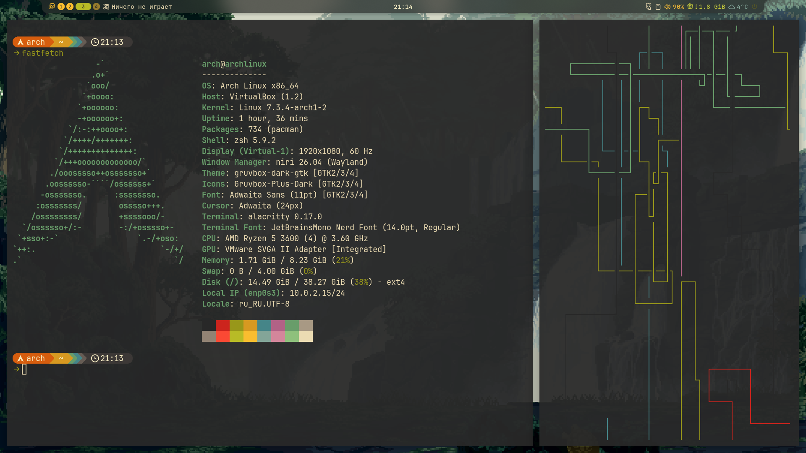
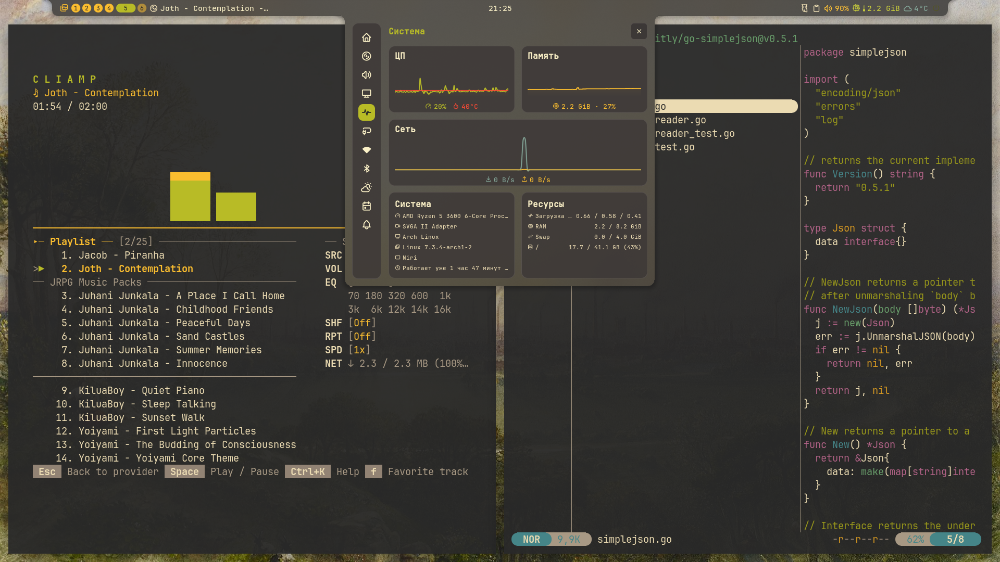
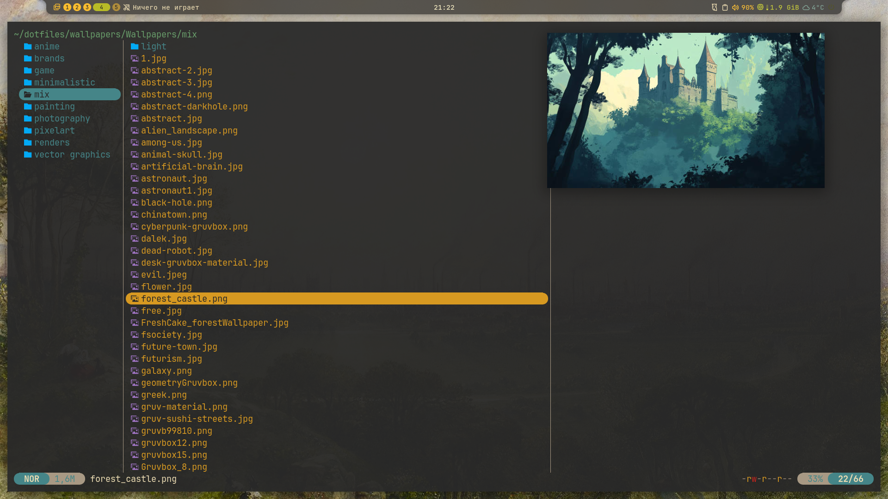

<div align="center">

# 🔸 Niri + Noctalia Shell (Gruvbox Edition)

**[English](#-english)** • **[Русский](#-русский)**

---

## 🇬🇧 English

A minimalist **Arch Linux** rice based on the **Niri** scrollable-tiling Wayland compositor and **Noctalia Shell**, styled with the **Gruvbox Dark** color palette.



</div>

---

## ✨ System Components

| Component | Software | Description |
| :--- | :--- | :--- |
| **WM / Compositor** | [Niri](https://github.com/niri-wm/niri) | Scrollable-tiling Wayland compositor |
| **Shell / Bar** | [Noctalia Shell](https://github.com/noctalia-dev/noctalia) | Top bar, widgets, notifications, and wallpaper manager |
| **Terminal** | [Alacritty](https://alacritty.org) | Fast GPU-accelerated terminal in Gruvbox Dark colors |
| **Shell & Prompt** | [Zsh](https://zsh.org) + [Starship](https://starship.rs) | Shell with *Pastel Powerline* prompt and `bat` |
| **App Launcher** | [Fuzzel](https://codeberg.org/dnkl/fuzzel) | Minimalist Wayland application launcher |
| **File Manager** | [yazi](https://github.com/sxyazi/yazi) | Blazing fast terminal file manager |
| **Theming** | [nwg-look](https://github.com/nwg-piotr/nwg-look) | GTK3/GTK4 theme and icon configurator |

---

## 📸 Gallery

| Launcher & File Manager | Wallpapers in yazi ([credits](https://github.com/AngelJumbo/gruvbox-wallpapers)) |
| :---: | :---: |
|  |  |

---

## 📁 Repository Structure

```text
dotfiles/
├── alacritty/    # Alacritty terminal configuration
├── fuzzel/       # Fuzzel launcher styles and settings
├── gtk/          # GTK3/GTK4 themes, fonts, and nwg-look settings
├── niri/         # Niri compositor configuration (config.kdl)
├── noctalia/     # Noctalia Shell settings, palettes, and plugins
├── screenshots/  # Desktop screenshots
├── starship/     # Starship prompt configuration (starship.toml)
├── wallpapers/   # Gruvbox wallpaper collection
├── zsh/          # Zsh shell configuration (.zshrc)
└── install.sh    # Automated installation script
```

---

## 🚀 Quick Installation

> **Note:** This script is designed for **Arch Linux** and uses `yay` to install AUR packages. All existing configurations are automatically backed up to `~/.dotfiles_backup_*`.

1. **Clone the repository:**
   ```bash
   git clone https://github.com/toor24deb/niri-gruvbox.git ~/dotfiles
   cd ~/dotfiles
   ```

2. **Run the installer:**
   ```bash
   ./install.sh
   ```

### Manual Installation (via GNU Stow)
If you want to apply only specific modules without installing packages:
```bash
cd ~/dotfiles
stow niri noctalia alacritty fuzzel zsh starship gtk wallpapers
```

---

## ⚠️ VirtualBox / VM Note

This configuration was built and tested inside an **Arch Linux** virtual machine. If you run it on bare metal and encounter display or cursor issues, check the `output` and cursor sections in `niri/.config/niri/config.kdl`.

---
---

<div align="center">

## 🇷🇺 Русский

Минималистичный райс **Arch Linux** на базе **Niri** и оболочки **Noctalia Shell** в палитре **Gruvbox Dark**.


</div>

---

## ✨ Компоненты системы

| Компонент | Программа | Описание |
| :--- | :--- | :--- |
| **WM / Compositor** | [Niri](https://github.com/niri-wm/niri) | Скроллящийся тайлинговый Wayland-композитор |
| **Shell / Bar** | [Noctalia Shell](https://github.com/noctalia-dev/noctalia) | Верхняя панель, виджеты, уведомления и менеджер обоев |
| **Terminal** | [Alacritty](https://alacritty.org) | Быстрый GPU-терминал в цветах Gruvbox Dark |
| **Shell & Prompt** | [Zsh](https://zsh.org) + [Starship](https://starship.rs) | Оболочка с промптом *Pastel Powerline* и утилитой `bat` |
| **App Launcher** | [Fuzzel](https://codeberg.org/dnkl/fuzzel) | Минималистичный Wayland-лаунчер приложений |
| **File Manager** | [yazi](https://github.com/sxyazi/yazi) | Терминальный файловый менеджер |
| **Theming** | [nwg-look](https://github.com/nwg-piotr/nwg-look) | Настройка тем оформления GTK3/GTK4 и иконок |

---

## 📸 Галерея

| Лаунчер и файловый менеджер | Обои в yazi ([credits](https://github.com/AngelJumbo/gruvbox-wallpapers)) |
| :---: | :---: |
|  |  |

---

## 📁 Структура репозитория

```text
dotfiles/
├── alacritty/    # Конфиг терминала Alacritty
├── fuzzel/       # Стили и настройки лаунчера Fuzzel
├── gtk/          # Темы GTK3/GTK4, шрифты и настройки nwg-look
├── niri/         # Конфиг композитора Niri (config.kdl)
├── noctalia/     # Настройки панели, палитры и плагины Noctalia Shell
├── screenshots/  # Скриншоты рабочего стола
├── starship/     # Конфиг промпта Starship (starship.toml)
├── wallpapers/   # Коллекция обоев в стиле Gruvbox
├── zsh/          # Конфигурация оболочки (.zshrc)
└── install.sh    # Скрипт автоматической установки
```

---

## 🚀 Быстрая установка

> **Внимание:** Скрипт рассчитан на **Arch Linux** и использует `yay` для установки пакетов из AUR. Все существующие конфиги автоматически сохраняются в резервную копию `~/.dotfiles_backup_*`.

1. **Клонируйте репозиторий:**
   ```bash
   git clone https://github.com/toor24deb/niri-gruvbox.git ~/dotfiles
   cd ~/dotfiles
   ```

2. **Запустите установку:**
   ```bash
   ./install.sh
   ```

### Ручная установка (через GNU Stow)
Если вы хотите применить только отдельные модули без установки пакетов:
```bash
cd ~/dotfiles
stow niri noctalia alacritty fuzzel zsh starship gtk wallpapers
```

---

## ⚠️ Примечание для VirtualBox / VM

Конфигурация создавалась и тестировалась в виртуальной машине на базе **Arch Linux**. Если вы запускаете сборку на реальном железе и столкнулись с особенностями вывода изображения или курсора, проверьте секцию `output` и настройки курсора в `niri/.config/niri/config.kdl`.
